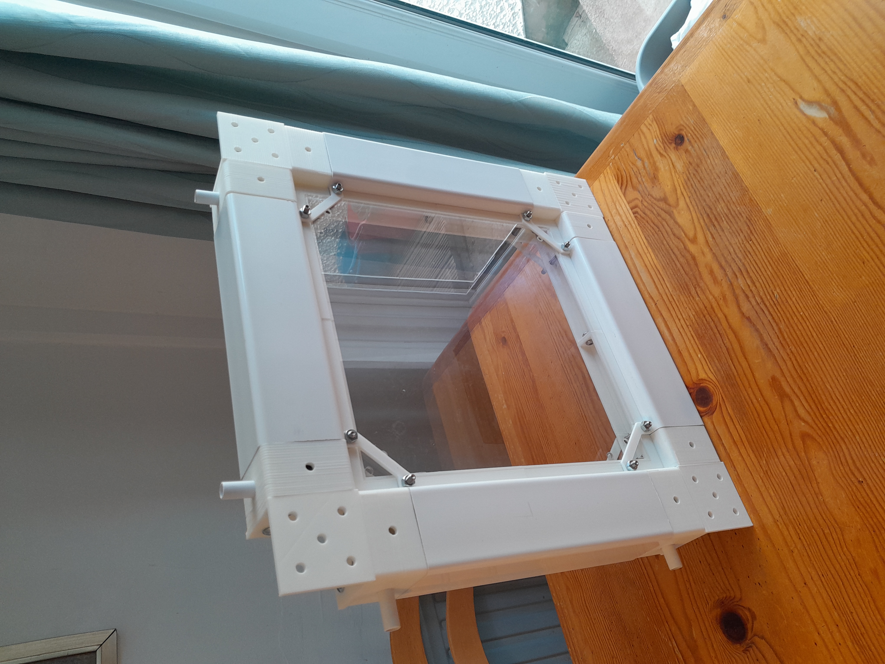

# ROMBI - Rapid  Open Modular Building Initiative

 <table>
  <tr>
    <td width="65%" valign="top">
      
In its simplest form, ROMBI consists of modular panels that can be made with practically no skills. There are some good modular framing systems out there, such as V-slot and T-slot, but they are typically meant for engineers. They are too heavy, too expensive, and relatively inaccessible to the average person. I came up with this system to make modular construction faster, affordable and accessible.

The main ROMBI panel is made from a combination of standard British FloPlast square drain pipe, 3D printed corner connectors, and off-the-shelf acrylic sheets. As such, it is very affordable. Unfortunately, different countries have different standards, and there isn’t much I can do about that. However, the repository can be cloned and adapted to cater for different countries and standards.
  
    </td>
    <td width="35%" valign="top">
      
    </td>
  </tr>
</table>

 <table>
  <tr>
    <td width="65%" valign="top">

The size of a single panel is 455mm x 455mm x 65mm. All sizes are multiples of 65mm, the size of the PVC square pipe. E.g. 65 x 7 = 455. This allows you to use the square pipe for floor and roof panels. 

    </td>
    <td width="35%" valign="top">
      
    </td>
  </tr>
</table>

 <table>
  <tr>
    <td width="65%" valign="top">
     <h2>Windows & Doors</h2>
      
The design doesn’t include openable windows and doors yet. I plan to use V-slot (see the adjecent image) for the doors due to the advanced sliding/railing systems. I want the doors to be more futuristic/advanced, as opposed to the typical style.
 
    </td>
    <td width="35%" valign="top">
      
    </td>
  </tr>
</table>

# Components & Files

Below are the STL files for the main panel. Please note that I made them using Sketchup Online, and was thus only able to export as STL format. At some point I will try to provide other formats.  

| Image | Description | Link to file |
|:---:|---|:---:|
|  | **3-Way Cube Corner Connector** (or Bracket / Trihedral Corner) | [STL](path/to/3-way-cube-corner-connector.stl) |
|  | **3-Way Corner Cover** | [STL](path/to/3-way-corner-cover.stl) |
|  | **3-Way Corner Spindle** | [STL](path/to/3-way-corner-spindle.stl) |
|  | **Panel Clip** | [STL](path/to/panel-clip.stl) |
|  | **Panel Holder Corner** | [STL](path/to/panel-holder-corner.stl) |
|  | **Panel Holder Long** | [STL](path/to/panel-holder-long.stl) |
|  | **Hole Cover** | [STL](path/to/hole-cover.stl) |
|  | **Hole Cover** | [STL](path/to/hole-cover.stl) |

# Materials

PLASTIC (PVC + PERSPEX)

FloPlast PVC Square downpipe 65x65X1.95mm cut to 245mm (BS EN 12200-1: 2004)
300x300x3mm perspex sheets. 
Round PVC pipe (12mm OD / 10mm ID) cut into 40mm sections (Cezar RURA OKR 12x1mm PVC BIALY bar code 5904584828225)

METAL (NUTS & BOLTS & OTHER)

M6 Female Threaded Steel Gas Spring Strut Joint End Fitting
M6 x 20mm (ISO 7380-2:2011) hexagon socket button head screws with an integrated flange (collar). These are used to connect the 3-Way Cube Corner bracket to the spindles.  
Standard UK M6 metric hexagon nut (DIN 934 / ISO 4032) - 10 mm spanner size (width across flats) and a 5 mm nominal height. 
M6 hex stud connector (18mm)  
Fully Threaded Rod, M6 x 350mm Right Hand Thread Bar Studs with Nuts
Aluminium 20x20mm corner cube / connector (OpenBuilds / V-Slot)
M6 x 16mm (L) x 10mm (head size). A2 Stainless Steel Allen Bolts Socket Cap Screws Hex Head (DIN912) 

# Equipment 

3D Printer - Ender 3 KE / PETG filament + drier
Stanley clamping mitre box with saw

# Limitations of modular systems

There are two main limitations of modular systems; security (preventing unauthorized access), and waterproofing. 

Security: Naturally, the more secure a structure is, the less modular it will be. If it’s easy to build and maintain, it will be easy to steal and sabotage. However, that doesn’t mean it is impossible to apply security techniques to prevent unauthorized access, it just means it should be an after-thought. For example, the window panels are very easy to replace. However, to get around this, you could use one-way bolts, with the nut on the inside of the building. Even still, this shouldn’t be a part of the VMOD core. After all, you might live in a gated community, or decide to put the structure inside another, more secure structure. I (and hopefully others) will provide security add-ons, and you can choose which is the most suitable.  

Waterproofing: The use of sealant would make the structure less modular. It might be tempting, but it should be a last resort. As above, add-ons will be available, but waterproofing will not be a part of the VMOD core. Perhaps you might want to consider putting the structure inside a large greenhouse or geodesic dome. Some do this in Scandinavia, and there are many benefits of doing so. Alternatively, you might want to put it under a gazebo, or inside a warehouse, shipping container or van.  

Open-Plan: Open-plan spaces typically require a large support beam. However, it’s worth bearing in mind that the maximum length of square downpipe in the UK is 5.5 meters. As such you can build an open-plan space that size. The pipe won’t provide much structural strength, but it’s fine for a single-story structure with an outer shell. 

Windows & Doors: Since we don’t know what we are building, it’s quite hard to design a universal system for windows and doors. I suggest using v-slot for this purpose. 

## Principles of Modular Design, and how ROMBI Addresses Them

A truly modular building system should aim to meet the following principles. ROMBI is designed around these principles, with the intention of making construction more accessible, adaptable and sustainable.

| Principle | Description | How ROMBI addresses it |
|---|---|---|
| **Accessibility** | Materials and components should be inexpensive and readily available. | ROMBI uses standard PVC square downpipe, M6 threaded rods, off-the-shelf Perspex sheets and 3D-printed connectors. Users are encouraged to substitute locally available materials to suit their region. |
| **Flexibility and Reusability** | Components should be reusable and adaptable to different applications without requiring a complete rebuild. | The modular connectors and panels allow structures to be assembled, disassembled, reconfigured and repurposed. |
| **Precision and Consistency** | Components should have consistent dimensions and interfaces, allowing them to fit together reliably. | ROMBI uses defined component dimensions and standardised connection points. Future revisions will aim to improve tolerances and interchangeability. |
| **Lightweight Construction** | Components should be lightweight enough to handle and assemble without heavy equipment. | The system uses lightweight PVC framing, thin sheet materials and 3D-printed connectors, reinforced with threaded steel rods where required. |
| **Simple Assembly and Maintenance** | Structures should be quick to assemble, disassemble and maintain, ideally without power tools. | The system is designed around modular connections and commonly available hardware, minimising the need for specialist tools or permanent fixings. |
| **Structural Integrity** | Connections and structural members should work together to provide adequate strength and stability for their intended application. | ROMBI incorporates steel threaded rods and aluminium V-slot corner cubes into its reinforced frame design. Structural performance must be validated for each intended application. |
| **Version Control** | Design changes should be documented so that components and assemblies can be identified, reproduced and improved. | ROMBI uses numbered design series, beginning with Series 1. Design files and documentation are maintained in a version-controlled repository. |
| **Flat-Packability and Portability** | Components should be easy to transport and store, with minimal wasted space. | The system can be disassembled into individual components and flat-packed. In principle, a building can be dismantled, transported and reassembled at a new location. |
| **Environmental Responsibility** | Materials and construction methods should minimise waste and environmental impact throughout the product lifecycle. | Reusability, lightweight transportation, repairability and the avoidance of concrete and timber in the primary frame are design considerations. Material durability, recyclability and whole-life impacts remain important considerations. |
| **Customisation** | Users should be able to adapt the appearance and configuration to their own preferences. | Frame colours can be selected to suit available materials, while 3D-printed connectors and accessories can be produced in different colours. Panels, dimensions and layouts can be adapted to individual projects. |
| **Cross-Compatibility** | A modular system should integrate with established products, components and standards wherever practical. | ROMBI is intended to accommodate compatible third-party systems, including V-slot aluminium extrusion for doors, openable windows and other accessories. |
| **Integrated Cable Management** | Electrical cables and other services should be accommodated without unnecessarily obstructing the structure or requiring extensive modifications. | Holes in the corner connectors allow cables to pass internally or externally. Unused openings can be closed with removable plugs. |
| **Scalability** | The same underlying principles should apply to projects of different sizes, from small enclosures to larger structures. | ROMBI is being developed as a common modular platform for a range of applications, with the long-term aim of scaling from small prototypes towards larger buildings. |
| **Repairability and Replaceability** | Individual parts should be replaceable without requiring the entire structure to be dismantled or discarded. | Modular construction allows damaged or outdated components to be replaced individually, subject to accessibility of the relevant connections. |
| **Open Design and Collaboration** | Design files and documentation should be available so that others can inspect, reproduce, modify and improve the system. | ROMBI is intended to be an openly documented project. Users are encouraged to fork the repository, adapt the designs to locally available materials and contribute improvements. |
| **Documentation and Reproducibility** | A design should be documented well enough for others to understand, reproduce and maintain it without relying on the original designer. | The project will include CAD and manufacturing files, assembly instructions, material specifications, photographs and records of design revisions. |
| **Adaptability to Local Materials** | A modular system should not depend on the availability of one particular material or product in every country. | Although the initial design uses UK-standard 65 mm square downpipe, the open design allows users to develop alternative connectors and structural dimensions for materials available in their own regions. |
| **Minimal Specialist Equipment** | Construction should be achievable by individuals and small groups without access to industrial machinery. | The system relies on accessible materials, 3D-printed components and common hardware, with the aim of keeping fabrication and assembly requirements manageable. |
| **Incremental Development** | A system should be useful at small scales before requiring users to commit to a large or expensive project. | ROMBI can be developed and tested through small applications before being extended to more complex assemblies and larger structures. |
| **Long-Term Adaptability** | Structures should be capable of evolving as requirements change, rather than becoming obsolete when a single component or use case changes. | Replaceable modules, standardised interfaces and documented revisions are intended to allow existing structures to be modified as new components and applications are developed. |

### A Living Design Philosophy

These principles are intended to guide the ongoing development of ROMBI rather than represent a claim that every objective has already been fully achieved. Prototypes, practical testing and community contributions will help identify shortcomings and guide future improvements.
