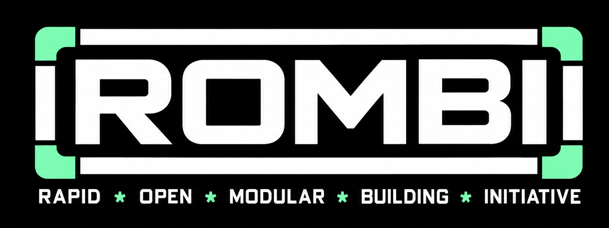

## IMPORTANT: ROMBI is under constant development. Though you are welcome to download and print the models, do so at your own risk. A better option would be to collaborate with me on a project.  

ROMBI is a modular construction system designed to make it possible to build a variety of structures quickly and easily, without requiring specialist building experience. The system is intended to be adaptable, reusable and relatively straightforward to assemble.
Potential applications include sleeping pods, vocal booths, pet shelters, office partitions, enclosures and many more.

## How does it work?

** It uses 3D-printed components, standard British 65 mm square downpipe and Perspex/acrylic panels. 
** Each panel has consistent, symmetrical dimensions of 455 × 455 × 65 mm.. 
** An internal metal framework uses threaded rods and V-slot aluminium corner cubes for reinforcement.. 
** The components stack and connect together, rather like Lego, with the ability to lock the panels into position.. 
** The panels are double-glazed, allowing different materials and configurations to be used for insulation, sound reduction, privacy or visibility.. 
** Panels attach to the main framework using a custom fitting called the Keyslot, which combines the principles of a T-slot and a keyhole connection.. 

There are some good modular framing systems out there, such as V-slot and T-slot, but they are typically meant for engineers. They are too heavy, too expensive, and relatively inaccessible to the average person. That said, I plan to develop doors using V-slot aluminium. However, my priority is to ensure that the core ROMBI system is thoroughly tested before expanding into additional components. 

ROMBI is intended to be an open, evolving project. The idea is that anyone can access the designs, adapt them to their own requirements and contribute to further development.

I'd really appreciate is some honest feedback! Also...

A lot of time and money has already gone into this project. Please help me to continue by making a donation:

## Documentation

- [Assembly Guide](docs/assembly-guide.md)
- [Materials and Tools](docs/materials-and-tools.md)
- [Design Principles](docs/design-principles.md)
- [Use Cases](docs/use-cases.md)

Please also check out: - [Why ROMBI Could Be a Good Fit for Liberland](docs/rombi-and-liberland.md)  

 

## NOTE: Below are photos of the prototype. The core design has since changed, although still roughly the same. There maybe also be some inconsistencies, such as mismatching corner connectors, which will be addressed in due course. I will upload more photos as the project progresses.   

  <table>
      <tr>
              <td>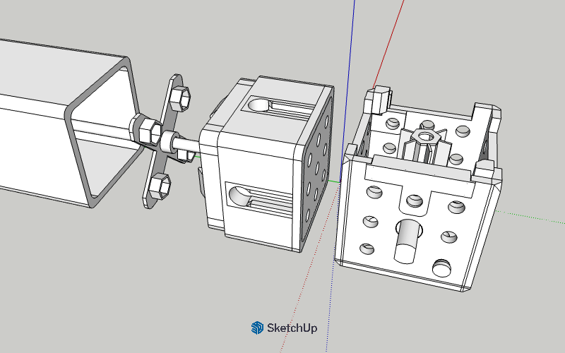</td>
              <td>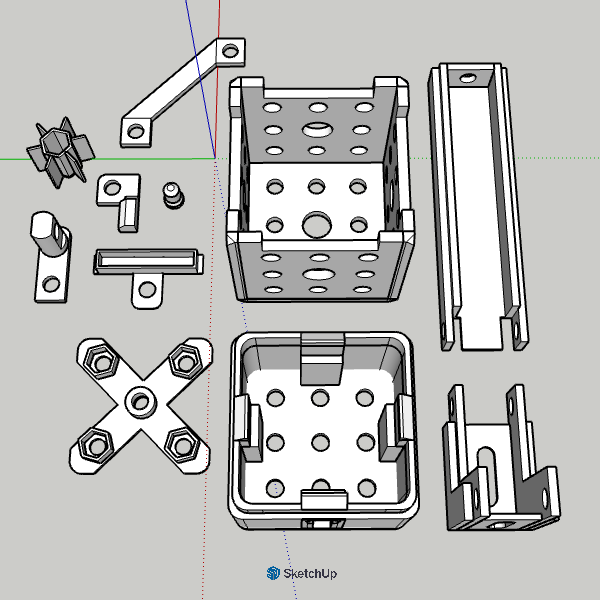</td>
              <td>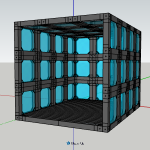</td>
              <td>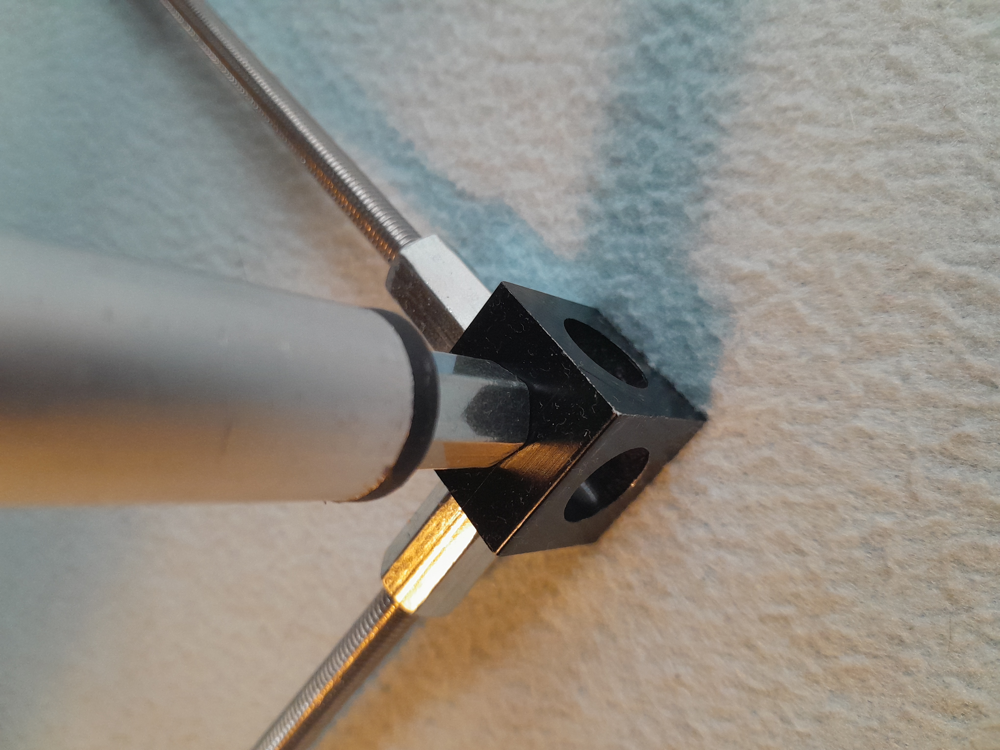</td>
        </tr>
    <tr>
      <td>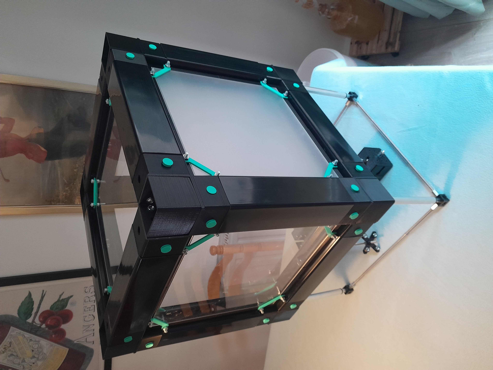</td>
      <td>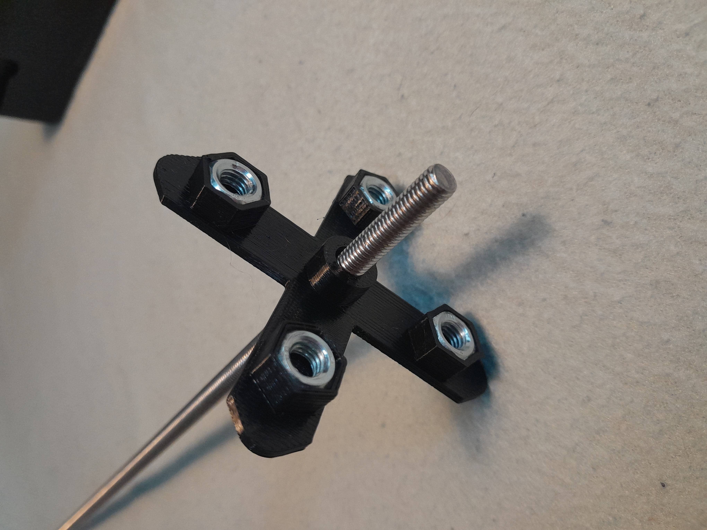</td>
      <td>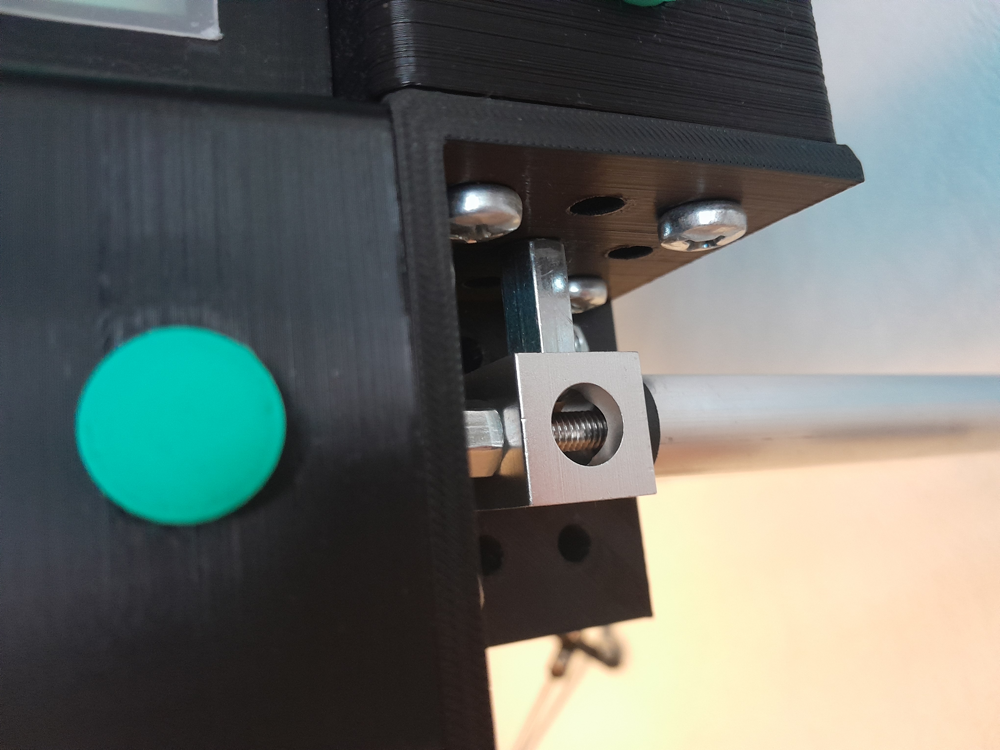</td>
      <td>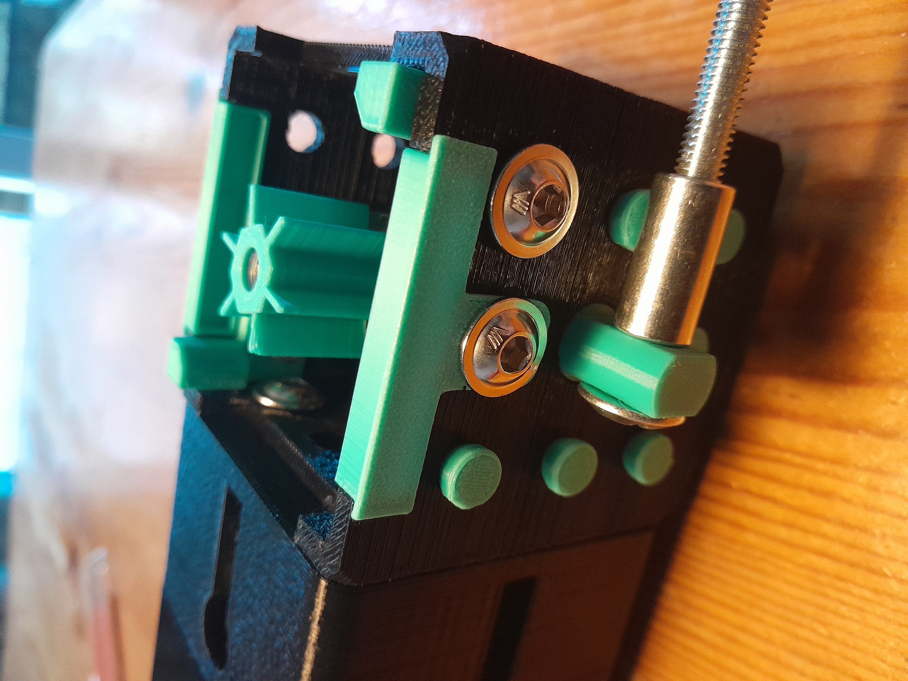</td>
    </tr>
        <tr>
              <td>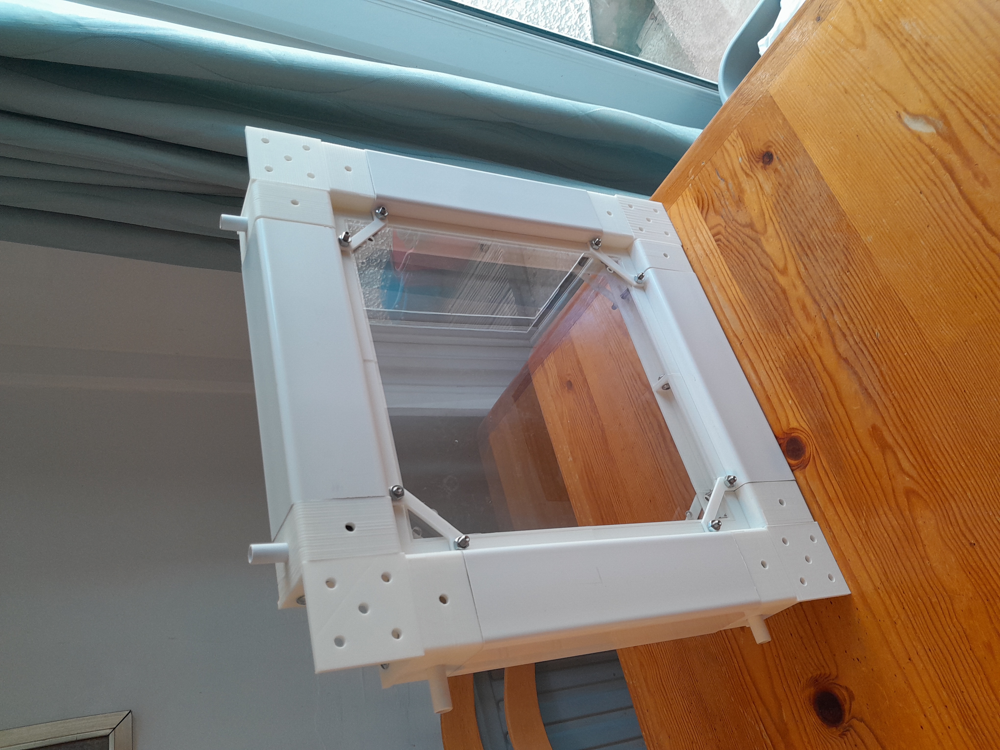</td>
              <td>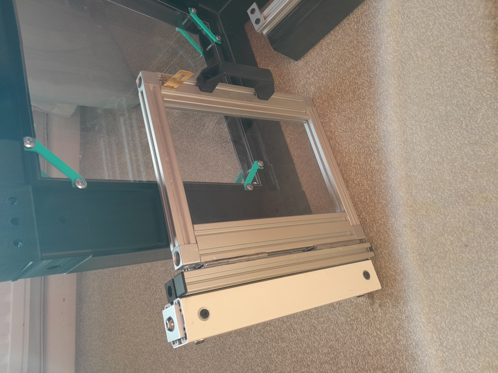</td>
              <td>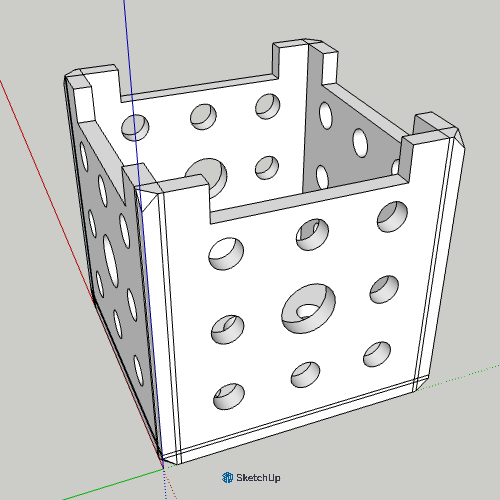</td>
              <td>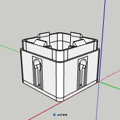</td>
        </tr>
  </table>

ROMBI is made from a combination of standard British FloPlast square drain pipe, 3D printed corner connectors, and off-the-shelf perspex sheets. As such, it is very affordable. The square pipe is currently available in black, white and brown, while the 3D printed connectors can be any colour. 

Different countries have different standards. The repository can be cloned and adapted accordingly. However, I don't plan to cater for different standards quite yet.
  

 
ROMBI can be used for Room Partitions, Sensory Deprivation Enclosures, Cinema, Gaming & VR Booths, Children's Mini-Cinemas & Hideaways, Personal Focus & Video-Call Booths, Vocal, Voiceover & Podcast Booths, Mobile DJ & Karaoke Booths, Photo & Content-Creation Booths, Pet Shelters & Animal Enclosures, Livestock & Veterinary Recovery Enclosures, Kiosks & Exhibition Booths, 3D Printer & Equipment Enclosures, Generator Enclosures Server & Network Enclosures, Food Fermentation & Proofing Chambers, Hydroponic & Growing Chambers, Battery Energy Storage, Enclosures Emergency & Earthquake Shelters, and more. 

ROMBI is currently version 1, marked as V1. It will stay on V1 until a core change has been made (affecting the majority of components). At which point a new folder will be created (V2), with V1 kept as legacy. Ideally, there won't be many (if any) changes to the core.

The size of a single panel is 455mm x 455mm x 65mm. All sizes are multiples of 65mm, the size of the PVC square pipe. E.g. 65 x 7 = 455. This allows you to use the square pipe for floor and roof panels.

<h2>Windows & Doors</h2>
The design doesn’t include openable windows and doors yet. I plan to use V-slot (see the adjecent image) for the doors due to the advanced sliding/railing systems. I want the doors to be more futuristic/advanced, as opposed to the typical style.
 
