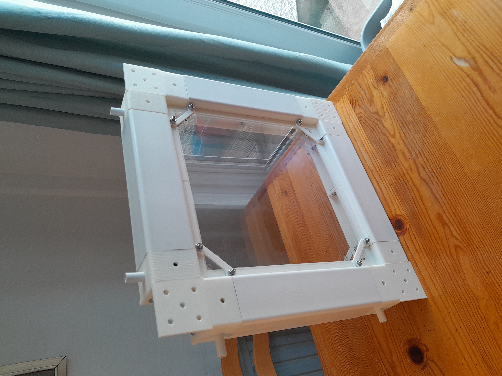
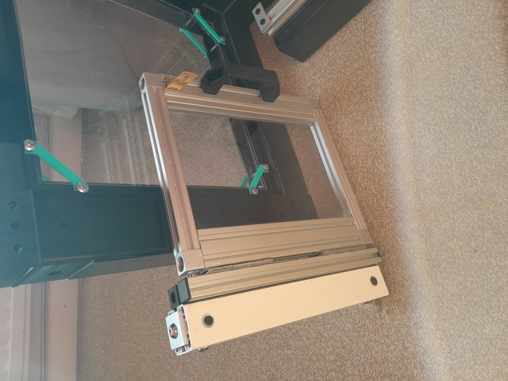

# ROMBI - Rapid  Open Modular Building Initiative
      

ROMBI consists of modular panels that can be made with practically no skills. There are some good modular framing systems out there, such as V-slot and T-slot, but they are typically meant for engineers. They are too heavy, too expensive, and relatively inaccessible to the average person. I came up with this system to make modular construction fast, affordable and accessible.

A lot of time and money has already gone into this project, and I plan to keep improving it. Please support me by making a donation:

## Documentation

- [Assembly Guide](docs/assembly-guide.md)
- [Components](docs/components.md)
- [Materials and Tools](docs/materials-and-tools.md)
- [Design Principles](docs/design-principles.md)
- [Use Cases](docs/use-cases.md)

## NOTE: Below are photos of the prototype. The core design has since changed, although still roughly the same. There maybe also be some inconsistencies, such as mismatching corner connectors, which will be addressed in due course. I will upload more photos as the project progresses.   

  <table>
    <tr>
      <td></td>
      <td></td>
      <td></td>
      <td></td>
      <tr>
        <td>193</td>
        <td>194</td>
        <td>195</td>
        <td>196</td>
      </tr>
      <td>213</td>
      <td>214</td>
      <td>215</td>
      <td>216</td>
    </tr>
    <td>223</td>
    <td>224</td>
    <td>225</td>
    <td>226</td>

 <table>
  <tr>
    <td width="65%" valign="top">

ROMBI is made from a combination of standard British FloPlast square drain pipe, 3D printed corner connectors, and off-the-shelf perspex sheets. As such, it is very affordable. The square pipe is currently available in black, white and brown, while the 3D printed connectors can be any colour. 

      

Different countries have different standards. The repository can be cloned and adapted accordingly. However, I don't plan to cater for different standards quite yet.
  

 
ROMBI can be used for Room Partitions, Sensory Deprivation Enclosures, Cinema, Gaming & VR Booths, Children's Mini-Cinemas & Hideaways, Personal Focus & Video-Call Booths, Vocal, Voiceover & Podcast Booths, Mobile DJ & Karaoke Booths, Photo & Content-Creation Booths, Pet Shelters & Animal Enclosures, Livestock & Veterinary Recovery Enclosures, Kiosks & Exhibition Booths, 3D Printer & Equipment Enclosures, Generator Enclosures Server & Network Enclosures, Food Fermentation & Proofing Chambers, Hydroponic & Growing Chambers, Battery Energy Storage, Enclosures Emergency & Earthquake Shelters, and more. 

    </td>
    
ROMBI is currently version 1, marked as V1. It will stay on V1 until a core change has been made (affecting the majority of components). At which point a new folder will be created (V2), with V1 kept as legacy. Ideally, there won't be many (if any) changes to the core.

    <td width="35%" valign="top">
      
    </td>
  </tr>
</table>

 <table>
  <tr>
    <td width="65%" valign="top">

The size of a single panel is 455mm x 455mm x 65mm. All sizes are multiples of 65mm, the size of the PVC square pipe. E.g. 65 x 7 = 455. This allows you to use the square pipe for floor and roof panels. 

    </td>
    <td width="35%" valign="top">
      
    </td>
  </tr>
</table>

 <table>
  <tr>
    <td width="65%" valign="top">
     <h2>Windows & Doors</h2>
      
The design doesn’t include openable windows and doors yet. I plan to use V-slot (see the adjecent image) for the doors due to the advanced sliding/railing systems. I want the doors to be more futuristic/advanced, as opposed to the typical style.
 
    </td>
    <td width="35%" valign="top">
      
    </td>
  </tr>
</table>
