[← Back to ROMBI home](../README.md)

## Assembly Guide

You can browse and download the 3D models from the STL folder. Prints should use PETG, and not PLA, to ensure that they are durable and weatherproof. If you have any questions, feel free to post an issue above. Alternatively, send me an email: glen_simister (at) yahoo.co.uk or message me via the ROMBI Facebook page.
  

## STEP 1: Build a strut

| Image | Description
|---|:---|
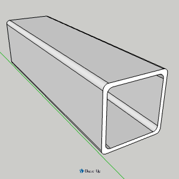 | Cut the square drain pipe into 245mm sections. I used a Stanley Mitre Box Saw. It's a non-electric saw with a guide to ensure a straight cut. Using an electric saw with PVC will create a lot of mess, and potentially break the pipe. | 
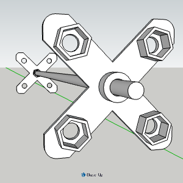 | Print 2 x [strut Fastener](../STL/V1/strut-fastener-V1.stl) objects. Take (2 x 5) standard UK hex nuts, and push them in to the hex slots. In the drawing there's 4 holes, but I have added one in the middle, which you can see in the STL. Thread the strut fasteners over the rod, leaving roughly 16.5mm thread on each end. I've created a [simple measuring tool](../STL/V1/16.5mm-measuring-tool-V1.stl) to help with this. Use nuts either side of the fastener to hold it in place. | 
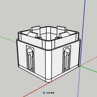 | Print 2 x [keyslot Spindle](../STL/V1/keyslot-spindle.stl) objects. For consistency, they should be the same color as the square pipe (black, white or brown). That said, it’s ultimately your choice.| 
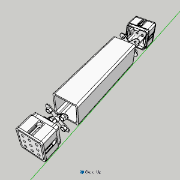 | Slide the two strut fasteners (including the rod) inside the pipe, and connect the keyslot spindles either side until the thread is visible on both ends. You should have roughly 12.5mm thread on each end.  | 
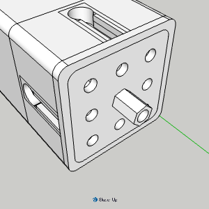 | Add a long hex nut (18mm) to each end. The strut is now finished. It's time to print the corner connectors. | 

## STEP 2: Build a corner

| Image | Description
|---|:---|
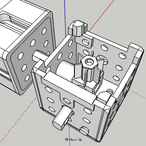 | This is the corner with all mods attached. Print the following components and put it together.| 
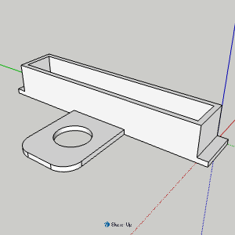 | Attach the [spanner slot cover](../STL/V1/spanner-slot-cover-V1.stl) - The purpose of the spanner slot is to allow enough room for a spanner to turn a vertical long hex nut. However, the long hex nut turner can be pushed over the hex nut to enable you to do it with your finger, or whatever. Both the spanner slot cover and the connector widget (below) are fastened via the same hole (top-middle).  | 
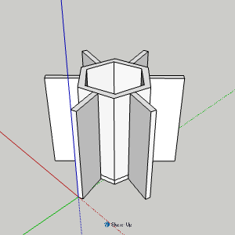 | Print a [long hex nut turner](../STL/V1/long-hex-nut-turner-V1.stl) and use it to attach the panels vertically (see below). | 
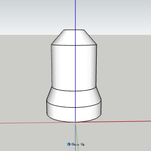 | Print some [hole plugs](../STL/V1/6mm-hole-plug-V1.stl) and push them in where you want to fill the holes. I will probably make these more discrete as they stick out too much. Also, I think it would be better to print them the same colour as the corner connector, to minimise visual clutter.  | 
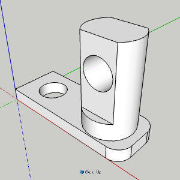 | Print 2 x [horizontal fastener](../STL/V1/connector-widget-V1.stl) objects. These are used for horizontal fastening on both sides of the connector, assuming it is a 2-way connector, and not a 3-way. You could also use an M6 gas strut head (eye bolt). They are stronger but can be a little bit expensive.| 
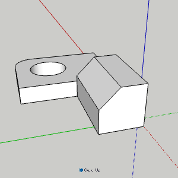 | 2 x [corner guide](../STL/V1/corner-guide-V1.stl) objects - The two corner guides should be fastened on opposite corners. The reason is because the ROMBI panels are stackable, and when they are stacked, the corner connectors have an inverse relationship with each other. So if you position the guides on the front left and back right, and then flip it upside-down, they will be front right, and back left.  | 
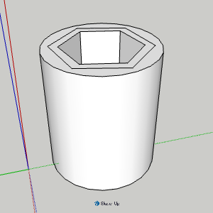 | Print 2/3 x [hex nut spacer](../STL/V1/hex-nut-spacer-V1.stl) objects. How many you print depends on whether it is a 3 way or 2 way corner. Once you have printed your components, slot the strut into the hole and push the hex nut spacer on the hex nut. It will probably be tight fit. The purpose of this spacer is to ensure that the aluminium corner cube is center aligned. Since all parts of the metal frame must be connected, you will need to purchase 20x20mm aluminium corner cubes, which are typically used for v-slot. When buying individually, they are not cheap, but the more you buy, and the longer you are willing to wait, the cheaper they are. NOTE: You won’t need to add the cube until all struts are connected. | 
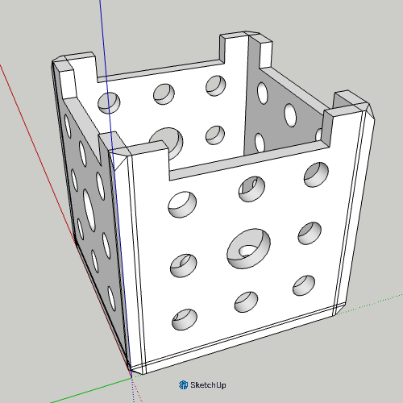 |  Attach the [5-Way Conector](../STL/V1/5-way-connector-with-spanner-slot-V1.stl) corner connector to the strut using M6 × 16 mm button-head bolts/screws with flange. It is recommended to use 1 in each corner. NOTE: Feel free to use whatever bolts you have available. | 

## STEP 3: Attach a panel

| Image | Description
|---|:---|
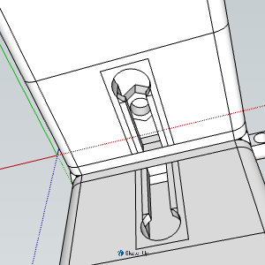 | Place a standard M6 hex inside the keyslot. If you prefer, you can also put a standard UK hex bolt in there instead. | 
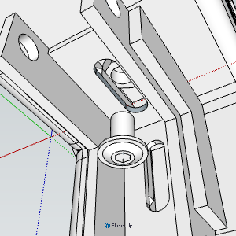 | Attach the corner panel bracket to the keyslot. The keyslot is 8mm depth, and the bracket is 2mm. As such, a 10mm M6 bolt with a washer is probably the best option.  | 
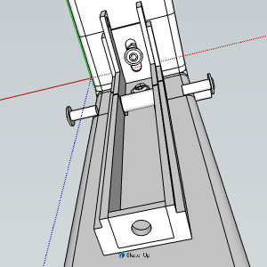 | Attach the long panel bracket to the corner panel bracket. Push an M6 coupling into the slot, and use 16mm M6 bolts either side to hold it together. NOTE: You can use one-way bolts if you want a structure which cannot be dismantled from the outside. You will still be able to loosen them from the inside. | 
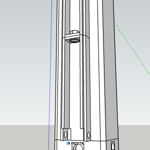 | Attach another long panel bracket to one already there. Use 16mm M6 bolts either to hold them together. | 
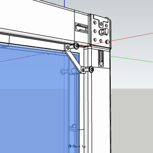 | Repeat all of the processes above until all struts, corners, and brackets are attached. Then, attach the perspex panel. It should rest in place, however, if it is stuborn, you will need to loosen the structure by loosening the long hex nuts on either side of the structs. Once both of the panels (front and back) are sitting nicely, tighten the structure, and add the panel clips to hold them in place. | 

## STEP 4: Stacking panel

This section is in progress. However, to summarize, you will need to repeat the steps above to complete an L-panel, or corner panel. Then stack them on top of each other. They should slot into place, as the corner connectors have guides. There's one important thing you will need to do in order to get them to fasten together vertically. The 5-way corner modules will contain aluminium corner cubes, which are there to hold the metal frame in place. The cubes are fastened to the frame via the long hex nut, on the end of the strut. They are fastened using 10mm M6 allen bolts. You will need to replace the downward facing bolt with a grub screw, that is 45mm (I need to double check the length) long. Then place a washer and hex nut no the screw to hold it in place. Then thread the long hex nut on the grub screw and place the hex nut turner object on the hex nut. This will enable you to spin it in order to attach the panels vertically. I will provide more detailed images in due course.  

| Image | Description
|---|:---|
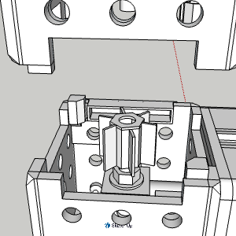 | Spin the hex turner to fasten the panels vertically. Notice how the guides slot into place to ensure the grub screws align.  | 
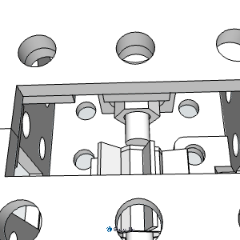 | A different view of the vertical fastener. | 

## STEP 4: Roofing

For narrow structures, say, one or two panels wide, you can apply the same system as you did for the vertical panels. After all, perspex panels can be fastened to all sides, though tricky for small cubes where you can't get inside. However, for larger, open plan spaces, you will need a different approach. Actually, there are many approaches, depending on your needs, but the simplest approach requires using a keyslot spindle (STL provided), which has a built-in pipe bracket. Let me explain... 

The bracket supports a common type of aluminium round pipe, which you can buy in places like B&Q (UK). It is 10mm inside diameter (ID) and 12mm outside diameter (OD). The pipe rests on top of the brackets, providing a shelf for the inner-roof (more square drain pipe) to sit on. It's not so easy to explain with words, so I will upload some more photos in due course. 

This approach allows you to add large beams, up to roughly 5m in length. For outdoor use, you will need a second layer, perhaps using 1mm perspex, or perhaps even a fabric cover. As mentioned in the section about [design principals](../docs/design-principles.md), waterproofing is something you should do yourself due to the many possible ways it can be done. 

Many traditional building methods have an inner frame, and an outer shell. The inner frame provides structural support for the ceilings/floors. This could also be done with ROMBI. For example, ROMBI has a modular metal frame, which could be positioned inside the structure to provide support for the ceiling. As I said, there many ways roofing can be done, and we can combine ways too. 

| Image | Description
|---|:---|
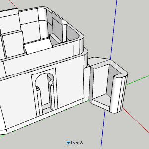 |  This spindle has a left-side pipe bracket that faces inwards. The aluminium pipe sits on top and provides a shelf for the square drain pipe (see the photo below). There are ways to provide props for additional support. [Download the STL here](../STL/V1/keyslot-spindle-round-pipe-bracket-left-V1.stl)   | 
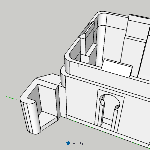 | This spindle has a right-side pipe bracket that faces inwards. The aluminium pipe sits on top and provides a shelf for the square drain pipe (see the photo below). There are ways to provide props for additional support. [Download the STL here](../STL/V1/keyslot-spindle-round-pipe-bracket-right-V1.stl)  | 

 
Below is a photo of these brackets in action.  

| Image | Description
|---|:---|
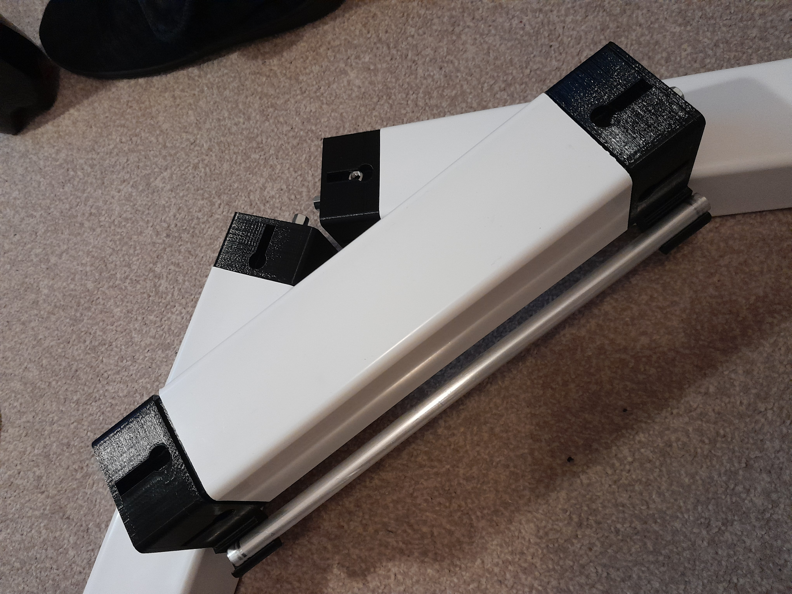 |   This photo is just a prototype. I am yet to build a structure big enough to warrant a roof. Also, the brackets in the photo are not exactly the same as the STLs provided, which have a 4mm ridge to prevent the pipe sliding. The aluminium pipe should be cut to 317mm in length (316.8 mm to be safe). | 

 
Theorectically speaking, you are now in a position to build a structure like the following:    

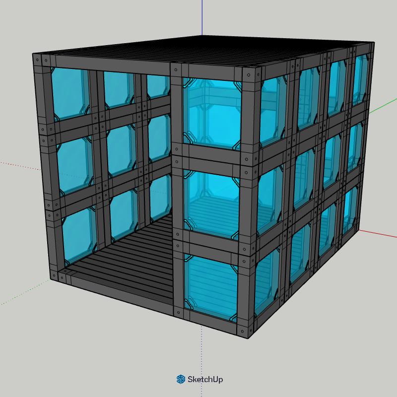

   
I will continue to add more photos, and improve the documentation as I build more stuff. Please contact me with any questions you may have on glen_simister (at) yahoo.co.uk, connect with me via the ROMBI Facebook page, or submit an issue above.  

