[← Back to ROMBI home](../README.md)

## This section is currently in progress. I hope to include clear photos, PowerPoint presentations, and perhaps even videos. 

You can browse and download the 3D models from the STL folder. Prints should use PETG, and not PLA, to ensure that they are durable and weatherproof. If you have any questions, feel free to post an issue above. Alternatively, the ROMBI Facebook page is also a good place to ask questions.
  

## Step 1: Build a strut

| Image | Description
|---|:---|
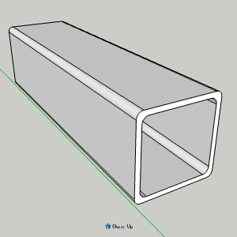 | Cut the square drain pipe into 245mm sections. I used a Stanley Mitre Box Saw. It's a non-electric saw with a guide to ensure a straight cut. Using an electric saw with PVC will create a lot of mess, and potentially break the pipe. | 
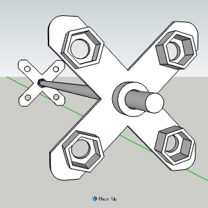 | Print 2 x [Hex Nut Holder](../STL/V1/hex-nut-holder-V1.stl) objects. Take (2 x 4) standard UK hex nuts, and push them in to the hex slots. Slide the Hex Nut Holders over the rod, leaving roughly 16.5mm thread on each end. You can adjust the nuts accordingly. NOTE: I will try to make this process easier by adding guides to ensure there is 16.5mm thread on each end and hold the Hex Nut Holder in place. But for now, it’s fine. | 
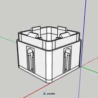 | Print 2 x [keyslot Spindle](../STL/V1/keyslot-spindle.stl) objects. For consistency, they should be the same color as the square pipe (black, white or brown). That said, it’s ultimately your choice.| 
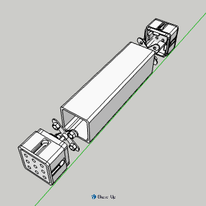 | Slide the two Hex Nut Holders (including the rod) inside the pipe, and connect the keyslot spindles either side until the thread is visible on both ends. You should have roughly 12.5mm thread on each end.  | 
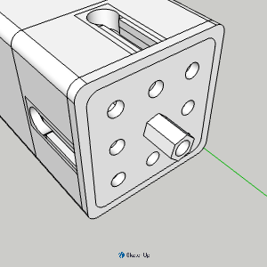 | Add a long hex nut (18mm) to each end. The strut is now finished. It's time to print the corner connectors. | 

## STEP 2: Build a corner

| Image | Description
|---|:---|
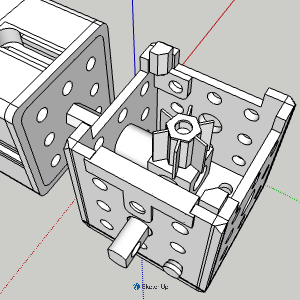 | This is the corner with all mods attached. Print the following components and put it together.| 
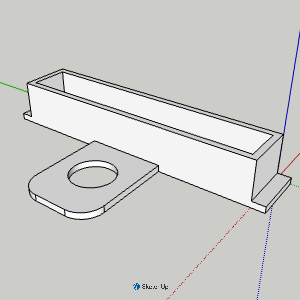 | Attach the [spanner slot cover](../STL/V1/spanner-slot-cover-V1.stl) - The purpose of the spanner slot is to allow enough room for a spanner to turn a vertical long hex nut. However, the long hex nut turner can be pushed over the hex nut to enable you to do it with your finger, or whatever. Both the spanner slot cover and the connector widget (below) are fastened via the same hole (top-middle).  | 
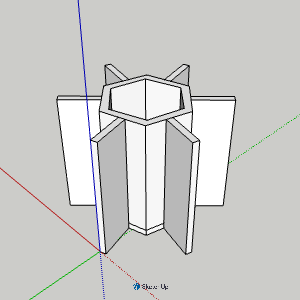 | 1 x STL/V1/long-hex-nut-turner-V1.stl  - This is to lock the panels vertically (see below). | 
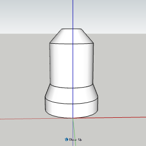 | STL/V1/6mm-hole-plug-V1.stl - push these in where you want to fill the hole. I will probably make these more discrete as they stick out too much. Also, I think it would be better to print them the same colour as the corner connector, to minimise visual clutter.  | 
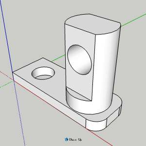 | 2 x STL/V1/connector-widget-V1.stl  - This is used for horizontal fastening on both sides of the connector, assuming it is a 2-way connector, and not a 3-way. | 
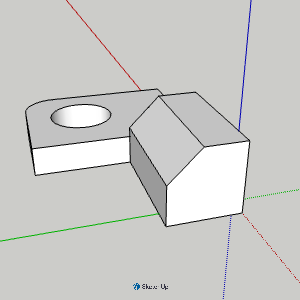 | 2 x STL/V1/corner-guide-V1.stl  - The two corner guides should be fastened on opposite corners. The reason is because the ROMBI panels are stackable, and when they are stacked, the corner connectors mirror each other. So if you position the guides on the front left and back right, and then flip it upside-down, they will be front right, and back left.  | 
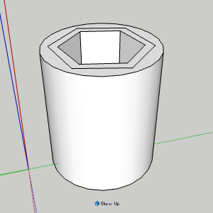 | 2/3 x hex-nut-spacer-V1.stl   -  How many you print depends on whether it is a 3 way or 2 way corner. Once you have printed your components, slot the strut into the hole and push the Hex Nut spacer on the hex nut. I will probably be tight fit. The purpose of this spacer is to ensure that the aluminium corner cube is center aligned. Since all parts of the metal frame must be connected, you will need to purchase 20x20mm aluminium corner cubes, which are typically used for v-slot. When buying individually, they are not cheap, but the more you buy, and the longer you are willing to wait, the cheaper they are. NOTE: You won’t need to add the cube until all struts are connected. | 
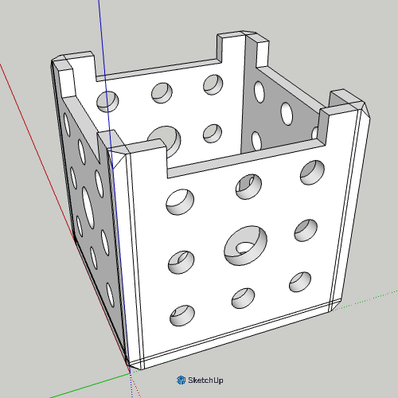 |  Attach the [5-Way Conector](../STL/V1/5-way-connector-with-spanner-slot-V1.stl) corner connector to the strut using M6 × 16 mm button-head bolts/screws with flange. It is recommended to use 1 in each corner. NOTE: Feel free to use whatever bolts you have available. | 

## STEP 3: Attach a panel

| Image | Description
|---|:---|
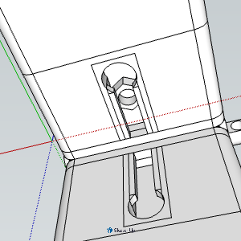 | Place a standard M6 hex inside the keyslot. If you prefer, you can also put a standard UK hex bolt in there instead. | 
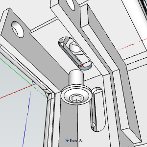 | Attach the corner panel bracket to the keyslot. The keyslot is 8mm depth, and the bracket is 2mm. As such, a 10mm M6 bolt with a washer is probably the best option.  | 
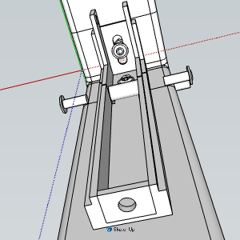 | Attach the long panel bracket to the corner panel bracket. Push an M6 coupling into the slot, and use 16mm M6 bolts either side to hold it together. NOTE: You can use one-way bolts if you want a structure which cannot be dismantled from the outside. You will still be able to loosen them from the inside. | 
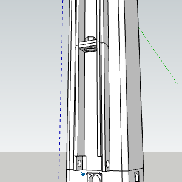 | Attach another long panel bracket to one already there. Use 16mm M6 bolts either to hold them together. | 
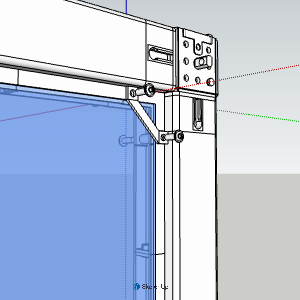 | Repeat all of the processes above until all struts, corners, and brackets are attached. Then, attach the perspex panel. It should rest in place, however, if it is stuborn, you will need to loosen the structure by loosening the long hex nuts on either side of the structs. Once the panel is sitting nicely, tighten it up, and add the panel clips to hold them in place. | 

## STEP 4: Stack a panel

This section is in progress. However, to summarize, you will need to repeat the steps above to complete an L-panel, or corner panel. Then stack them on top of each other. They should slot into place, as the corner connectors have guides. There's one important thing you will need to do in order to get them to fasten together vertically. The 5-way corner modules will contain aluminium corner cubes, which are there to hold the metal frame in place. The cubes are fastened to the frame via the long hex nut, on the end of the strut. They are fastened using 10mm M6 allen bolts. You will need to replace the downward facing bolt with a grub screw, that is approximately 35mm long. Then place a long hex nut on the grub screw, and then place the hex nut turn object on the hex nut. This will enable you to spin it in order to attach the panels vertically. I will provide detailed images in due course.   

