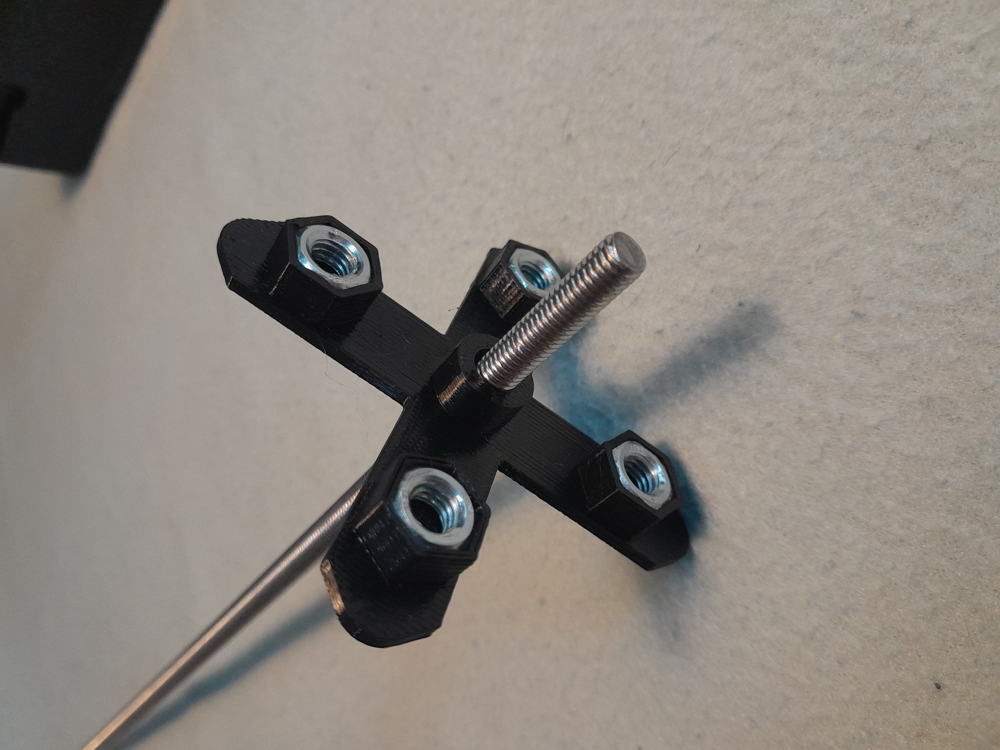

[← Back to ROMBI home](../README.md)

## This section is currently in progress. I hope to include clear photos, PowerPoint presentations, and perhaps even videos. 

## Step 1: Building the struts

| Image | Description
|---|:---|
 | Cut the square drain pipe into 245mm sections. I used a Stanley Mitre Box Saw. It's a non-electric saw with a guide to ensure a straight cut. Using an electric saw with PVC will create a lot of mess, and potentially break the pipe. | 
 | Print 2 x PETG Hex Nut Holder objects. Take 4 x standard UK hex nuts, and push them in to the slots.| 
 | Slide the Hex Nut Holders over the rod, leaving roughly 16.5mm thread on each end. You can adjust the nuts accordingly. NOTE: I will try to make this process easier by adding guides to ensure there is 16.5mm thread on each end and hold the Hex Nut Holder in place. But for now, it’s fine. | 
 | Print 2 x PETG keyslot Spindle objects. For consistency, they should be the same color as the square pipe (black, white or brown). That said, it’s ultimately your choice.| 
 | Slide the Hex Nut Holders plus rod inside the pipe, and connect the keyslot spindles either side until the thread is visible on both ends. You should have roughly 12.5mm thread on each end.  | 
 | Add a long hex nut (18mm) to each end. The strut is now finished. It's time to print the corner connectors. | 

## STEP 2: Create the corners

Print the following components and put it together: 

| Image | Description
|---|:---|
 | STL/V1/5-way-connector-with-spanner-slot-V1.stl - Fasten the corner connector to the strut using allen bolts. It is recommended to use 1 in each corner.  This could be the last step, if you think it would be easier. | 
 | STL/V1/spanner-slot-cover-V1.stl - The purpose of the spanner slot is to allow enough room for a spanner to turn a vertical long hex nut. However, the long hex nut turner can be pushed over the hex nut to enable you to do it with your finger, or whatever. Both the spanner slot cover and the connector widget (below) are fastened via the same hole (top-middle).  | 
 | 1 x STL/V1/long-hex-nut-turner-V1.stl  - This is to lock the panels vertically (see below). | 
 | STL/V1/6mm-hole-plug-V1.stl - push these in where you want to fill the hole. I will probably make these more discrete as they stick out too much. Also, I think it would be better to print them the same colour as the corner connector, to minimise visual clutter.  | 
 | 2 x STL/V1/connector-widget-V1.stl  - This is used for horizontal fastening on both sides of the connector, assuming it is a 2-way connector, and not a 3-way. | 
 | 2 x STL/V1/corner-guide-V1.stl  - The two corner guides should be fastened on opposite corners. The reason is because the ROMBI panels are stackable, and when they are stacked, the corner connectors mirror each other. So if you position the guides on the front left and back right, and then flip it upside-down, they will be front right, and back left.  | 
 | 2/3 x hex-nut-spacer-V1.stl   -  How many you print depends on whether it is a 3 way or 2 way corner. Once you have printed your components, slot the strut into the hole and push the Hex Nut spacer on the hex nut. I will probably be tight fit. The purpose of this spacer is to ensure that the aluminium corner cube (see below) is center aligned. Since all parts of the metal frame must be connected, you will need to purchase 20x20mm aluminium corner cubes, which are typically used for v-slot. When buying individually, they are not cheap, but the more you buy, and the longer you are willing to wait, the cheaper they are. NOTE: You won’t need to add the cube until all struts are connected. | 

