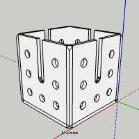
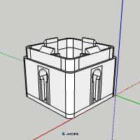
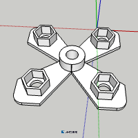
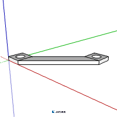
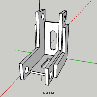
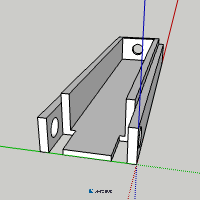

# Components & Files

Below are the STL files for the main panel. Please note that I made them using Sketchup Online, and was thus only able to export as STL format. At some point I will try to provide other formats.  

| Image | Description | Link to file | Version
|:---:|---|:---:|:---:|
|  | **5-Way Corner Connector** | [STL](../STL/V1/5-way-connector-with-slots-V1.stl) | 1 | 
|  | **Keyhole Spindle** | [STL](../STL/V1/keyhole-spindle-V1.stl)  | 1 | 
|  | **Hex Nut Holder** | [STL](../STL/V1/hex-nut-holder-V1.stl)  | 1 | 
|  | **Panel Clip** | [STL](../STL/V1/panel-clip-V1.stl)  | 1 | 
|  | **Panel Holder Corner** | [STL](../STL/V1/panel-holder-corner-slotted-V1.stl)  | 1 | 
|  | **Panel Holder Long** | [STL](../STL/V1/panel-holder-long-V1.stl)  | 1 | 
