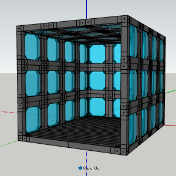

# Why ROMBI Could Be a Good Fit for Liberland

## A modular construction system for floating communities

**ROMBI — Rapid Open Modular Building Initiative** is an open-source modular construction project designed to make building simple, accessible and adaptable.

ROMBI aims to enable people to construct standardised, lightweight, enclosed structures without requiring conventional building experience, specialist tools or complicated construction methods. 

I believe this approach could be particularly interesting for **Liberland**, where the development of buildings and infrastructure on floating platforms presents some unusual challenges.

## Why floating construction needs a different approach

Building on water is fundamentally different from building on solid ground.

Structures must be supported by pontoons, rafts or other floating platforms. Weight, stability, transportation and ease of assembly therefore become particularly important considerations.

Conventional construction methods can also be difficult to apply. For example:

- Heavy building materials increase the demands on floating platforms.
- Timber can be relatively heavy and requires protection against moisture and rot.
- Conventional glass glazing adds weight and can be difficult to handle.
- Cutting, drilling and assembling materials on a floating platform can be awkward.
- Traditional construction often assumes access to a stable building site, workshops and specialist tradespeople.

One possible solution is to manufacture or prepare standardised building modules on land, transport them to the floating site and assemble them there.

This is the principle behind ROMBI.

## What is ROMBI?

ROMBI uses a repeatable modular panel system.

The basic panels are standardised at approximately **455 × 455 × 65 mm**. They can be connected and stacked to create different configurations, allowing the same components to be used for walls, corners, enclosed spaces and larger structures.

The intention is to make construction more like assembling a modular kit than building a conventional structure from scratch.

The system uses:

- **3D-printed components:** The connector designs are available through the GitHub project.
- **Standard British square PVC drainpipe:** Used to form the main panel framework.
- **Standard-size Perspex/acrylic panels:** Used for the glazing and available from online suppliers.
- **Threaded metal rods:** Used as part of the internal structural framework.
- **V-slot aluminium corner cubes:** Used to connect and reinforce the internal frame.

The use of readily available materials is deliberate. People should be able to source components locally where possible, rather than depending on a single manufacturer or supplier.

The current design uses standard British materials, but adapting the system to equivalent materials available in other countries is an important part of the open-source concept.

## How the system works

### 1. Modular construction

The panels are designed to stack and connect, rather like building blocks.

They can be assembled into different arrangements, allowing structures to be created incrementally. Additional modules can be added as required, while existing structures can potentially be dismantled or reconfigured.

This could be useful for floating communities where buildings may need to expand, change purpose or be relocated.

### 2. Internal metal reinforcement

Inside the main framework is a metal reinforcement system using threaded rods and V-slot aluminium corner cubes.

The threaded rods connect the internal framework, providing reinforcement within the modular structure.

Panels can also be locked together vertically by threading and fastening the connections into position.

### 3. Secure but maintainable connections

ROMBI can use one-way security bolts to make external connections more resistant to unauthorised removal.

Importantly, the connections can still be loosened from the inside, allowing authorised access for maintenance and disassembly.

This is intended to provide a balance between security and maintainability.

### 4. Double-glazed, interchangeable panels

The panels are double glazed using standard-size Perspex/acrylic sheets.

The glazing is attached using removable clips, making it possible to remove or replace panels without dismantling the entire structure.

This creates opportunities for different panel types, including:

- Clear panels for natural light and visibility.
- Opaque panels for privacy.
- Insulated panels for improved thermal performance.
- Sound-reducing panel configurations.
- Replaceable panels for repair or future upgrades.

The ability to change the panels means that a structure does not have to remain permanently configured for one particular purpose.

### 5. The ROMBI Keyslot fitting

One of the features of the system is a connection I call the **Keyslot fitting**.

It combines techniques associated with a keyhole fitting and a T-slot connection.

The purpose is to make it quick and straightforward to attach the panel framework to the main structure, while still allowing it to be removed when necessary.

This is important because a modular building system should not only be easy to assemble; it should also be easy to maintain, repair and dismantle.

The Keyslot fitting is intended to reduce the number of complicated assembly operations and make the system more accessible to people without specialist building experience.

## Potential applications in Liberland

ROMBI is not limited to conventional houses. Its modular design could potentially support a range of smaller structures and facilities.

### Small accommodation and sleeping pods

One particularly interesting application is compact individual accommodation.

A sleeping pod could be approximately the size of a one-person tent, with an enclosed space around twice the footprint of a coffin. The exact dimensions would depend on the intended use and layout.

Such units could potentially provide:

- Compact individual sleeping spaces.
- Temporary accommodation.
- Private spaces within larger floating developments.
- Modular accommodation that can be combined or rearranged.

Small units could be constructed on land and transported to their floating locations for assembly.

### Modular rooms and buildings

Larger structures could be created by connecting multiple modules.

Potential applications include:

- Living spaces.
- Workshops.
- Storage facilities.
- Offices and workspaces.
- Communal facilities.
- Small commercial or service units.

The same underlying components could be used across different applications, reducing the need to develop entirely different construction systems for each building.

### Adaptable floating infrastructure

A modular system could also be useful for facilities that need to change over time.

Rather than treating every building as a permanent, fixed structure, modules could potentially be added, removed, relocated or repurposed as the settlement develops.

## An open-source approach

ROMBI is being developed as an open project.

The intention is not simply to sell a proprietary building system, but to make the design accessible so that other people can experiment with it, improve it and adapt it to their own requirements.

The GitHub repository provides a starting point for this:

[**Visit the ROMBI GitHub repository**](https://github.com/glensimister/rombi)

The project includes 3D-printable components and supporting documentation. As development continues, further assembly instructions, photographs and design improvements will be added.

People with access to a 3D printer could produce the connectors themselves, while those without one could use a commercial 3D-printing service.

The system is intended to encourage local production and adaptation rather than dependence on a central supplier.

## What needs to be investigated?

ROMBI is still under development. Although the modular concept and prototype components have been demonstrated, using the system for permanent floating buildings would require further engineering, testing and validation.

Some of the important areas to investigate include:

- Buoyancy and the additional weight of completed structures.
- Stability and wind loading on floating platforms.
- Structural performance of the connections.
- Long-term exposure to water, moisture and sunlight.
- Fire performance of the materials.
- Thermal insulation and condensation management.
- Weatherproofing and ventilation.
- Safe access, emergency escape and building regulations.

These are not minor details, and I would not claim that ROMBI is already a certified or proven marine construction system.

However, I believe the underlying modular approach provides an interesting starting point for investigation.

## An invitation to Liberland

I would be very interested in discussing ROMBI with people involved in Liberland's development, particularly those interested in construction, infrastructure, engineering, architecture and floating settlements.

The project is at an early stage, which means there is an opportunity to influence its development and explore applications that might not have been considered yet.

I would welcome:

- Technical feedback and criticism.
- Suggestions for improvements.
- Collaboration with engineers, designers and builders.
- Opportunities to test the system in practical applications.
- Ideas for adapting the materials and components to local availability.

**My aim is to develop a construction system that makes building more accessible, modular and adaptable.**

I believe floating communities could be an especially interesting environment in which to explore that idea.

If you are interested in the project, please contact me here or at: glen_simister (at) yahoo.co.uk
